# Workflow de video MiniMax H3 no Maestro

Data: 2026-08-16  
Contrato: `maestro-minimax-h3-production@2026-08-16`

Decisao complementar: `ferramentas/video_global_engine/docs/decisions/ADR-005-vejito-blue-rose-gated-action-workflow.md`.

## Decisao pragmatica

### Face Refine automatico — pedido do proprietario em 03/10/2026

Novos videos H3 recebem `PemaraH3FaceRefine` antes de `CreateVideo`, usando YuNet
CPU, canvas 512, 12 passos e denoise 0,45. O passe usa H3 Base FL2VA e SageAttention
mesmo quando a origem usa Ref2VA, PDD ou FastH3. O audio nativo original segue para
o video final; o passe facial nao substitui seu audio. O MP4 bruto fica preservado.
Sem rosto detectado, o video original segue; erro de deteccao bloqueia o passe.

O inventario e os backups estao em `ferramentas/h3_face_refine_20261003/receipts`.
Os 34 workflows inventariados recebem a etapa, e um handler do runtime cobre
novas submissões de grafos antigos. Isso nao corrige classes opcionais ausentes
de templates experimentais. Rostos recompostos continuam candidatos: deteccao
e mascara preservada nao equivalem a identidade confirmada ou aprovacao artistica.

O teste de Leon/Licker pede um take unico de 30 segundos com audio nativo.
O grafo usa a janela longa explicitamente solicitada, 736 quadros a 24 FPS;
a entrega conserva 720 quadros (30 s), removendo 16 quadros finais em uma copia
e aparando o audio no mesmo tempo. O original completo permanece guardado.
Essa janela excede a duracao calibrada de 4–15 s e exige revisao integral do take.
As duas ancoras do teste aguardam aprovacao do proprietario antes do render.

Para produzir um clipe profissional, o minimo real e:

1. roteiro dividido em takes e com continuidade definida;
2. fotos ancora perfeitas e aprovadas nos pixels;
3. prompts amarrados pela skill oficial local `h3-prompt-writing`;
4. contrato de movimento e fisica para cada take e conector;
5. QC tecnico mais aprovacao humana em imagem e audio;
6. acabamento e backup rastreaveis.

O unico motor autorizado a gerar video e o **MiniMax H3**. Qwen/FLUX podem criar ou corrigir fotos
ancora. RIFE, RealESRGAN e FFmpeg apenas tratam takes ja aprovados. HunyuanVideo-Foley gera audio
somente depois do picture lock.

## Fluxograma do trabalho

```mermaid
flowchart TD
    A["Ideia e objetivo"] --> B["Roteiro e continuidade"]
    B --> C{"Proprietario aprova o roteiro?"}
    C -- "nao" --> B
    C -- "sim" --> D["Fotos ancora start/end + sidecar"]
    D --> E{"Ancora perfeita e elenco conferido?"}
    E -- "nao" --> D
    E -- "sim" --> F["Compilador oficial h3-prompt-writing"]
    F --> G["Preflight sem GPU: identidade, fisica, camera e beats"]
    G --> H{"Contrato passou?"}
    H -- "nao" --> F
    H -- "sim" --> I["MiniMax H3: take nativo 24 fps"]
    I --> J["ffprobe + contact sheet + QC visual"]
    J --> K{"Proprietario aprova o take?"}
    K -- "nao" --> D
    K -- "sim" --> L["Conectores FL2VA de acao continua"]
    L --> M{"Sem crossfade, freeze, hold ou reset?"}
    M -- "nao" --> L
    M -- "sim" --> N["Picture lock"]
    N --> O["RIFE 4.6: candidato 60 fps"]
    O --> P["HunyuanVideo-Foley XXL por blocos"]
    P --> Q{"Proprietario aprova o audio?"}
    Q -- "nao" --> P
    Q -- "sim" --> R["Master audiovisual aprovado e imutavel"]
    R --> S["RealESRGAN FHD + NVENC: candidata separada"]
    S --> T{"Proprietario aprova o FHD exato?"}
    T -- "nao" --> S
    T -- "sim" --> U["Master final, hashes, loudness e rollback"]
```

## Caminho opcional: multi-shot para clipes longos

Este caminho atende projetos com cenas editoriais independentes cuja duracao final passa de um take H3. O video do [CG Pixel sobre 40 segundos em 6 GB](https://www.youtube.com/watch?v=85XQ_xcWX7U) serve como referencia de arquitetura: gerar varios planos com duracao controlada e monta-los no final. O autor relata 40 s em uma RTX 3060 de 6 GB, 16 GB de RAM, 0,6 MP e cerca de 107 minutos; e um relato do proprio autor, nao uma validacao independente de qualidade ou desempenho para este runtime.

Aplicacao no Maestro:

1. Planejar o clipe como takes editoriais separados. Cada chamada ao `H3VideoEngine` continua limitada a 4–15 segundos e 24 fps; nao transformar o clipe inteiro em um prompt/take unico.
2. Manter o perfil H3 existente e validar SageAttention ligado ao transformer no grafo ativo. O preset de baixa VRAM do tutorial nao substitui nem reconfigura os perfis locais.
3. Revisar e aprovar cada take antes de inclui-lo na sequencia. Usar a montagem de projeto existente, que exige fontes compativeis em codec, geometria e FPS, preserva os streams de video e registra quadros nas fronteiras para revisao.
4. Manter o audio completo e aprovado em todos os takes ou montar uma sequencia silenciosa; a montagem bloqueia misturas parciais de fontes com e sem audio.
5. Tratar qualquer upscale como candidata separada depois da aprovacao do master, conforme os gates de acabamento abaixo.

Usar este caminho para cortes entre cenas distintas. Para uma unica acao continua, manter o caminho de conectores FL2VA e seus contratos de movimento; concatenar cenas independentes nao cria continuidade de acao.

### Atualizacoes comunitarias verificadas em 28/09/2026

O inventario do ComfyUI local mostrou ComfyUI v0.37.0, `--fast fp16_accumulation`, o arquivo VAE de video H3 INT8 e o kernel fused do encoder. A parte de encoder da [otimizacao publicada pelo ComfyUI em 22/09](https://blog.comfy.org/p/making-the-minimax-h3-video-vae-2x) esta ativa: o kernel fused e automatico e a flag ativa acumulacao FP16 nas convolucoes. O post mede ate ~2,2x na codificacao e ~1,4–2,7x na decodificacao em NVIDIA, sem medicao local nesta verificacao. O decoder INT8 esta disponivel pelo arquivo local, mas nao confirmei se os workflows atuais o selecionam; se for comparar, manter como perfil separado e revisar a qualidade. Nao ha atualizacao de runtime necessaria para o caminho do encoder.

Os pesos e nodes PDD Acc H3 de 8 passos tambem estao disponiveis. Manter PDD como perfil opcional de comparacao, separado do perfil de producao; nao empilhar PDD com a Turbo LoRA ou outra destilacao. O caminho PDD nao substitui automaticamente o perfil H3 atual. A [tabela comunitaria de integracoes H3](https://github.com/MiniMax-AI/awesome-minimax-h3-integration) trata PDD 8 passos como opcao mais conservadora que FastH3 4 passos, que perde mais textura.

A mesma tabela aponta Sol-Attn para RTX 50. O ComfyUI local ja tem o node experimental `Model Sparse Attention` com metodo Sol-Attn; nao precisa instalar a extensao antiga, que foi marcada como redundante. A comunidade reporta 1,14–1,44x contra SageAttention numa RTX 5090 e 37% menos pico de VRAM de MLP, mas isso nao e uma medicao local. Como SageAttention continua sendo requisito do fluxo H3, Sol-Attn fica como candidato de laboratorio: so considerar depois de provar no grafo que o requisito continua atendido e de fazer comparacao isolada de qualidade/velocidade. Nenhuma atencao foi trocada nesta verificacao.

Para uma acao continua que precise ultrapassar o limite de um take, a comunidade publicou o [ComfyUI-H3-Motion-Context](https://github.com/NikoDemon80/ComfyUI-H3-Motion-Context). Ele transporta o latente conjunto de video e audio entre execucoes, recorta do resultado o trecho de contexto repetido e inclui uma sonda para medir emendas. Isso acrescenta continuidade audiovisual ao planejador/sampler finito de segmentos que ja existe localmente; nao e necessario para cortes entre cenas independentes. O repositorio declara suporte a ComfyUI 0.34+ e a [versao 0.6.2, de 06/09](https://github.com/NikoDemon80/ComfyUI-H3-Motion-Context/blob/main/CHANGELOG.md). A versao local 0.37 atende ao requisito declarado, mas a compatibilidade com as modificacoes locais do runtime ainda nao foi testada. O node nao esta carregado; fica como candidato isolado, sem instalacao ou render nesta verificacao.

O catalogo local tambem contem Qwen Image 2.1 INT8 ConvRot. A versao 2.1, [anunciada em 20/09](https://qwen.ai/blog?id=qwen-image-2.1), unifica geracao e edicao de imagem, aceita transparencia nativa e ate 10 imagens de referencia. E util para preparar recortes/ancoras e compor referencias para H3; continua sendo ferramenta de imagem, nao gerador de video, e a aprovacao da ancora continua obrigatoria. O guia abaixo foi alinhado ao checkpoint que esta no catalogo local.

## Desenho do workflow e dos modelos

```mermaid
flowchart LR
    subgraph Direction["Direcao e agentes"]
      P["project-planner"]
      C["creative-director"]
      CT["pemara-cinematic-take-director"]
      MD["pemara-video-motion-director"]
    end

    subgraph Anchors["Fotos ancora"]
      QI["Qwen Image 2.1 INT8 ConvRot"]
    end

    subgraph H3["Geracao audiovisual"]
      HP["h3-prompt-writing oficial local"]
      QV["Qwen3-VL-32B NVFP4 AWQ"]
      MM["MiniMax H3 FL2VA pruned INT8 ConvRot"]
      VV["Video VAE H3 FP16 / INT8"]
      AV["Audio VAE FP32 opcional"]
    end

    subgraph Finish["Acabamento apos aprovacao"]
      RF["RIFE 4.6"]
      RE["RealESRGAN x2plus"]
      NV["FFmpeg H.264 NVENC"]
      FO["HunyuanVideo-Foley XXL"]
    end

    P --> C --> CT --> QI
    QI --> HP
    MD --> HP
    HP --> QV --> MM
    MM --> VV
    MM --> AV
    VV --> RF --> RE --> NV
    NV --> FO
```

### Papel de cada modelo

| Modelo/ferramenta | Papel | Pode aprovar? |
|---|---|---|
| Qwen Image 2.1 INT8 ConvRot | criar, editar e recortar fotos ancora | nao |
| `h3-prompt-writing` | compilar estrutura, keyframes, timeline, som e musica | nao |
| Qwen3-VL-32B H3 | encoder multimodal/textual do H3 | nao |
| MiniMax H3 | unico gerador de video de producao | nao |
| Video/Audio VAE H3 | decodificar imagem e audio nativo | nao |
| RIFE 4.6 | interpolar take aprovado para 60 fps | nao |
| RealESRGAN x2plus | candidato FHD depois da aprovacao visual | nao |
| HunyuanVideo-Foley XXL | Foley sincronizado apos picture lock | nao |
| FFmpeg/ffprobe/EBU R128 | master, codec, metadados e loudness | nao |
| Proprietario | aprovar roteiro, ancoras, imagem, picture lock e audio | sim |

## Como agentes e skills trabalham juntos

O Maestro inventaria todo o catalogo instalado, mas roteia somente especialistas relevantes para
cada etapa. Rodar 300 skills ao mesmo tempo pioraria o sinal, aumentaria conflito de instrucoes e
nao acrescentaria qualidade. O endpoint `GET /api/generative/h3/workflow` informa o inventario e o
roteamento ativo. O endpoint
`GET /api/video-projects/{project_id}/takes/{take_id}/h3-workflow` executa o preflight real do take
sem enfileirar GPU.

Skills roteadas: planejamento, direcao criativa, direcao cinematografica de takes, producao de
imagem, direcao de movimento, prompt oficial H3, producao de video, audio, analise, debug, testes,
performance sem perda de qualidade, documentacao e automacao.

## Contratos inquebraveis

- Um take de producao nao nasce de prompt unico longo.
- Todo prompt H3 usa os campos oficiais e o modo coerente com as ancoras.
- FL2VA e Ref2VA usam checkpoints diferentes. Um grafo `MiniMaxH3ReferenceToVideo` carregando
  pesos FL2VA e bloqueado antes da fila.
- `first_frame` e `last_frame` sao ancoras temporais. `ref_images` sao referencias de aparencia;
  nunca recebem posicao na timeline e nao podem ser apresentadas como cinco keyframes exatos.
- `ref_videos` e referencia de movimento. Mesmo quando o arquivo mostra um esqueleto DWPose, o
  H3 nao possui entrada de pose e nao pode ser apresentado como controle articular exato.
- Cada take declara `control_claims.anchor_binding` e `control_claims.motion_binding`. O preflight
  compara essas promessas com modelo, no condicionador e conexoes reais do grafo.
- Conector usa FL2VA, uma unica acao irreversivel e movimento util nos tres intervalos.
- `crossfade_frames=0`, `freeze_frames=0`, `static_hold_frames=0`; reset e proibido.
- 24 fps e a cadencia nativa H3; 60 fps e entrega posterior por RIFE.
- Foley deve ser aprovado no master 60 fps antes do passe RealESRGAN. Isso evita gastar o upscale
  FHD quando o som ainda pode ser reprovado e mantém imagem, áudio e resolução como gates distintos.
- O master audiovisual aprovado permanece imutável. O FHD é uma nova candidata e nunca herda
  aprovação automaticamente.
- Preview ao vivo e opt-in e nao altera sampler, steps, encoder ou entrega.
- Otimizacao que possa perder fidelidade permanece em laboratorio.
- Nenhuma saida de modelo recebe aprovacao automatica.

## API e painel

- `GET /api/generative/status`: inclui `h3Workflow` com componentes, skills, etapas e prontidao.
- `GET /api/generative/h3/workflow`: diagnostico completo, somente por origem interna autorizada.
- `POST /api/generative/h3/compile-prompt`: compilacao oficial local; nao usa GPU nem API externa.
- `GET /api/video-projects/.../h3-workflow`: explica o preflight real e nao cria job.
- Em `Criar > Video`, o painel exibe o workflow completo e seu estado.

## Limite desta implantacao

Os testes e o debug podem validar contratos, API, UI, pesos e um projeto real sem gerar outro take.
Um render H3 pesado so deve ser iniciado numa janela de GPU explicitamente autorizada; candidato
tecnico continua pendente de revisao humana.

O H3 local atual nao pode prometer simultaneamente cinco ancoras temporais num passe e coreografia
articular exata. Esse contrato e recusado pelo Maestro; ele precisa ser dividido em segmentos
first/last adjacentes ou roteado, com autorizacao do proprietario, para um motor que exponha uma
entrada real de pose. Prompt, seed e video de referencia nao substituem esse controle.

## Reconstrucao em outro PC

O backup do sistema nao carrega pesos. Depois da restauracao, rode
`tools/model_installers/INSTALAR_TUDO_MODELOS.bat`: ele instala o FL2VA pruned INT8 ConvRot,
Qwen3-VL-32B NVFP4/AWQ, VAEs, RIFE 4.6, RealESRGAN x2 e Foley XXL. Fontes, revisoes, tamanhos e
SHA-256 ficam travados em `tools/model_installers/models.lock.json`; reruns retomam ou pulam o que
ja foi verificado.
