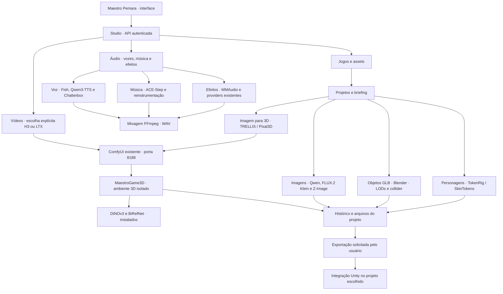

# Maestro Pemara — vídeo H3, áudio e jogos

Mapa da integração em 13/09/2026. A interface principal é o Maestro em
`http://127.0.0.1:9501`. O login e o proxy autenticado existentes foram preservados.

## Produção de vídeo com H3

O Codex opera o serviço ComfyUI exclusivamente pelo MCP. O backend do Maestro
continua autônomo quando o usuário solicita geração pela interface. O mapa não
representa autorização para gerar, aprovar ou publicar uma produção. A integração
de jogos não altera o seletor H3/LTX nem substitui a atenção do H3.

## Organização técnica

| Parte | Local |
| --- | --- |
| Interface principal | `app/index.html`, `app/assets/native-studios.js` |
| APIs de áudio e projetos | `services/studio/zico_audio.py` |
| Processamento GLB e rigging | `services/studio/game_assets.py` |
| Imagens para jogos | `services/studio/game_images.py` |
| Reserva e admissão de GPU | `gpu_lease.py`, `game_gpu_admission.py` |
| Projetos, jobs e exportações | `dados/game_ai` |
| Ambientes maiores de jogos | `D:/PemaraRuntimes/maestro-game-ai` |
| Ambiente Linux do SkinTokens | Ubuntu 24.04 · `/opt/maestro-game-ai/envs/skintokens` |

As gerações de GPU compartilham a reserva do Maestro. O backend só libera cache
ocioso do ComfyUI depois de verificar sua fila; não encerra outros processos.
Objetos estáticos são processados pelo Blender sem renderização de vídeo.

## Estado de ativação

Ativação administrativa concluída em 13/09/2026 às 09:59:45. O Studio 8029 carregou a revisão 2 da integração; sete rotas responderam HTTP 200. FLUX, Z-Image Base/Turbo, TRELLIS e Pixal3D foram anunciados como disponíveis. A revisão visual autenticada ainda depende do login habitual do proprietário.

Os testes 3D produziram GLBs válidos e conferidos no Blender. O fluxo atual gera malhas sem textura; testes técnicos não constituem aprovação artística. Evidência: dados/logs/maestro_native_activation_verified.json.
