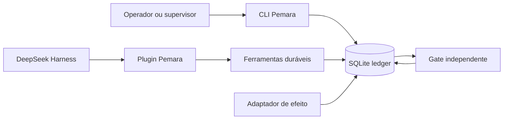
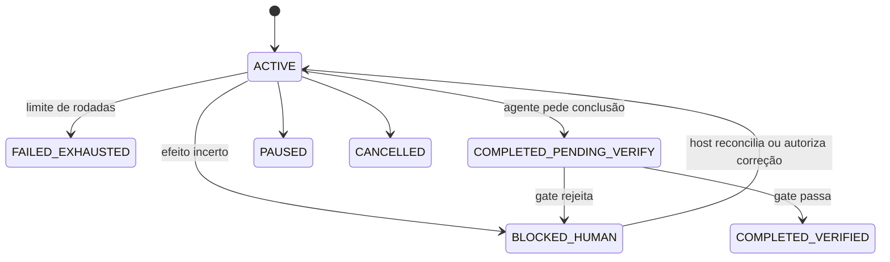
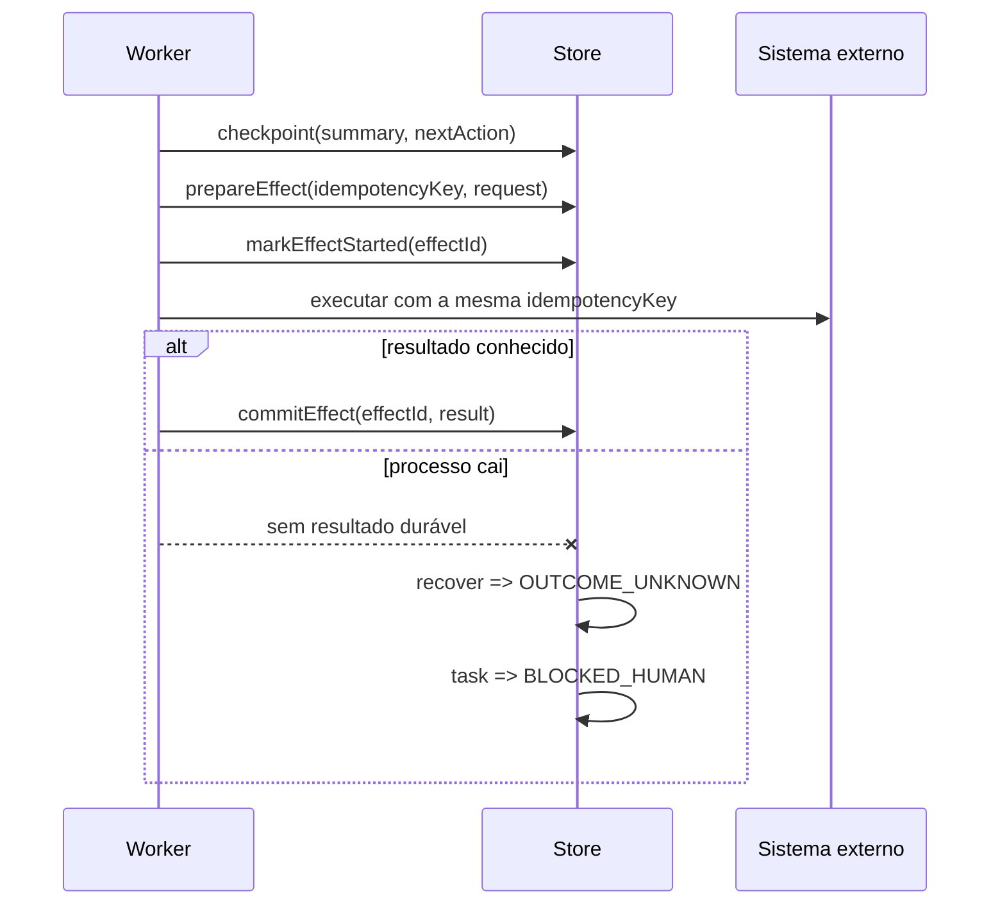
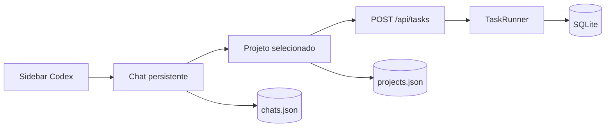

# Arquitetura

## Decisão central

O DeepSeek Harness continua responsável pelo loop do agente, ferramentas, contexto, compactação e sessão. O Pemara Harness acrescenta uma fonte de verdade independente para a unidade de trabalho de longa duração.

Essa separação evita transformar o event log de conversa em uma fila de trabalho implícita. Uma conversa pode ser compactada ou encerrada; a tarefa mantém seu objetivo, orçamento, checkpoint e efeitos.

## Estados de tarefa

`COMPLETED_PENDING_VERIFY` é deliberadamente não terminal do ponto de vista de promoção. O output do modelo é evidência candidata, não aprovação.

## Protocolo de efeito externo

O ponto difícil é a janela entre o efeito externo aceitar a operação e o processo gravar o resultado. O harness não inventa exactly-once genérico: ele registra a ambiguidade e exige reconciliação.

`resolveEffect` exige resolver, outcome e evidência; o último efeito incerto resolvido reativa a tarefa. `resumeTask` recusa a retomada enquanto existir qualquer `OUTCOME_UNKNOWN`. Ambas são APIs/CLI host-only e não são registradas como tools do modelo.

## Persistência

- SQLite `STRICT`, foreign keys habilitadas;
- `journal_mode=WAL` em arquivo;
- `synchronous=FULL`;
- `busy_timeout=5000`;
- todas as mutações usam `BEGIN IMMEDIATE`;
- `task_events(task_id, seq)` tem chave primária contígua;
- `effects(task_id, idempotency_key)` é único.

O schema atual é `2`, com journal de jobs e tentativas do supervisor. Bancos v1
continuam legíveis sem mutação para preservar o ledger operacional. A migração
v1 → v2 é explícita, transacional e faz rollback completo sob falha; versões
desconhecidas continuam recusadas sem alteração.

## Supervisor

`SupervisorStore` mantém uma exclusão própria, separada do lease do agente
filho. `supervisor_jobs` persiste comando/fingerprint, orçamento, backoff e lock;
`supervisor_attempts` registra cada PID, início, sessão capturada, heartbeat,
saída e resultado. Duas instâncias reais admitem somente um supervisor.

O runner relê a tarefa/checkpoint antes de cada tentativa. Depois de uma queda,
PID sozinho nunca comprova identidade. Filho morto vira tentativa interrompida;
PID vivo incompatível bloqueia em `OUTCOME_UNKNOWN`. A continuidade de sessão
segue o [ADR-001](decisions/ADR-001-checkpoint-rehydrated-supervisor.md).

## Integração DSH

O perfil vive fora do upstream em `.runtime/dsh-home/profiles/pemara`. O pacote é ligado como `@pemara/harness`; `cordis.patch.yml` seleciona o modelo local, configura a rota `pemara-qwen38` no adaptador oficial `llm-pi-ai` e insere `pemara-durable-harness` depois dos bundles oficiais `base` e `headless`.

A rota usa somente `http://127.0.0.1:11436/v1`, protocolo `openai-completions`, contexto 524288, saída máxima 16384 e modalidades texto/imagem. O placeholder `PEMARA_QWEN_API_KEY=llama-local` existe apenas no processo do launcher e é restaurado ao sair. O perfil DSH não administra a GPU; o launcher visual separado pode iniciar o GGUF e devolver cache ComfyUI comprovadamente ocioso, mas nunca encerra processos ou prompts ativos.

O plugin exporta `name`, `inject`, `Config` (Standard Schema) e `apply`, conforme o contrato de function plugin do DSH. Ele injeta apenas `tools` e `systemPrompt`, recupera o ledger ao montar e libera leases em descarte gracioso.

## Cockpit: conversa, projeto e tarefa

O monitor web mantém a experiência de navegação separada do ledger SQLite,
mas liga os dois por ids explícitos. `cockpit-store.mjs` persiste dois registros
JSON locais: projetos (`projectId`, caminho canônico e nome) e chats
(`chatId`, projeto, título, último objetivo e status). O workspace raiz é
`E:\Pemara`; a descoberta automática considera somente diretórios com marcas de
projeto e o registro manual aceita apenas caminhos dentro dessa raiz.

O navegador pode abrir uma nova conversa sem iniciar o modelo. Ao enviar, o
servidor resolve o projeto, verifica a fronteira, atualiza o chat e só então
cria o job. O runner grava `workspace`, `chatId` e `projectId` junto ao estado
da tarefa; uma conversa existente continua disponível mesmo que o processo do
DSH caia. No desktop a sidebar ocupa 264 px; em telas menores vira um drawer
com backdrop, mantendo o mesmo estado e as mesmas rotas loopback.

## Caminho multimodal

O browser envia cada arquivo por streaming ao loopback e recebe somente um id
opaco. O runner confere limites, grava de forma atômica, calcula SHA-256 e copia
os anexos para o diretório durável do job. Depois que o Qwen passa no gate de
GPU, `prepare-media-context.mjs` chama um adaptador Python fixo: imagens usam o
endpoint OpenAI-compatible do Qwen 3.8, áudios usam Faster-Whisper CPU e vídeos
combinam oito quadros via FFmpeg/Qwen com a transcrição da faixa sonora.

Antes de chegar ao DSH, caminho real, arquivo regular, tamanho e hash são
revalidados. Evidência é limitada, remove caminhos privados e recebe o rótulo
`media-untrusted-data`; texto visto ou ouvido nunca ganha autoridade de
instrução. O launcher passa apenas o arquivo de contexto preparado por variável
de ambiente temporária e restaura o ambiente ao encerrar.

## Builder v2 e adaptadores

O perfil `pemara-builder` v1 continua com cinco ferramentas de ledger e serve
como rollback somente leitura. O perfil isolado `pemara-builder-v2` recebe um
pacote host-owned e expõe exatamente oito ferramentas: as cinco duráveis mais
leitura, escrita e teste estreitos. Caminhos são arquivos exatos com baseline
SHA256; comandos são ids fixos cujo executável, argumentos, cwd, timeout e teto
de saída pertencem ao pacote validado pelo host.

`filesystem.atomic-write` usa temporário no mesmo diretório, flush, rename e
hash para reconciliar quedas. `git.local-candidate` cria objeto commit/ref local
sem mover `HEAD` ou a worktree e nunca acessa remoto. `subprocess.allowlisted`
persiste fingerprints e PIDs, usa ambiente saneado, encerra somente a árvore
autorizada no timeout e bloqueia rede/escrita pelo permission model do Node e
preload próprio. Cada comando de teste recebe uma área temporária endereçada
pelo estado do workspace, com leitura e escrita permitidas somente ali; a
worktree continua sem permissão lateral de gravação. Efeitos ambíguos viram
`OUTCOME_UNKNOWN`; não são repetidos.

O launcher inclui um preload compatível com Windows que só substitui
`os.userInfo()` quando libuv devolve `ENOMEM`. Isso permite carregar o TSX sob
pressão de commit sem alterar o comportamento normal ou o upstream DSH.

## Limites atuais

- A contagem de rodada continua explícita por ferramenta do agente.
- Ferramentas externas existentes do DSH ainda não passam automaticamente pelo protocolo `prepare/start/commit` do ledger.
- O perfil headless oficial cria uma sessão nova por invocação e não implementa
  `--resume`; o supervisor correlaciona a nova sessão com a tarefa/checkpoint por
  rebind host-only auditável conforme ADR-001.
- Não há observação cross-process em tempo real; consumidores relêem o SQLite.
- Não há política de retenção/remoção.
- HTTP, publicação, shell e Git bruto permanecem fora do Builder v2.
- A composição e o protocolo Qwen foram provados com mock determinístico e com o GGUF real: `/v1/models` confirmou `n_ctx=524288` e uma inferência retornou `PEMARA_QWEN_OK`. A partida continua subordinada aos gates de fila, atividade e VRAM.
