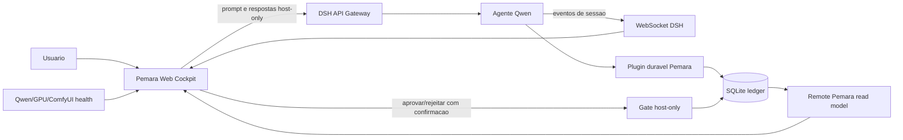

# Plano visual: Pemara Harness Web Cockpit

## Estado

- Status: aguardando revisao e aprovacao do proprietario.
- Implementacao: nao iniciada por este plano.
- Motivo deste arquivo separado: `tasks/plan.md` ja foi entregue ao Qwen em uma execucao ativa; este plano nao altera nem amplia aquela tarefa.
- Superficie-alvo: aplicacao web local aberta como janela de aplicativo no Windows, sem console permanente.
- Modelo-alvo: `qwen3.8-27b-uncensored-yarn-524k` em `127.0.0.1:11436`, preservando os gates atuais de fila, GPU e VRAM.

## Resultado esperado

Ao abrir o atalho **Pemara Harness**, o usuario deve entrar em uma interface visual semelhante em fluidez ao OpenCode Web, mas orientada ao trabalho duravel do Pemara:

- iniciar uma tarefa e conversar com o Qwen;
- acompanhar texto visivel, ferramentas, comandos, arquivos, testes, subagentes, plano e fila enquanto acontecem;
- ver o estado duravel da tarefa, rodadas, lease, checkpoint, proxima acao, efeitos e evidencias;
- distinguir claramente `executando`, `aguardando`, `offline`, `bloqueado`, `pendente de verificacao` e `concluido`;
- revisar diff e artefatos sem procurar em logs de terminal;
- aprovar ou rejeitar a conclusao por uma superficie host-only, nunca pelo modelo;
- fechar e reabrir a pagina sem perder a historia ja persistida.

Nao sera exibido nem inventado raciocinio privado do modelo. O cockpit mostra apenas narracao visivel, chamadas de ferramenta, resultados, eventos, checkpoints, arquivos, testes e estados realmente registrados.

## Decisao arquitetural recomendada

Usar a superficie Web oficial do DeepSeek Harness como fundacao e estende-la por composicao, sem modificar o checkout upstream.

O upstream ja possui:

- Web server em loopback;
- transporte HTTP para comandos e WebSocket para eventos;
- conversa com streaming, arvore de ferramentas e trajetoria;
- sidebar de sessoes, plano, jobs, skills, subagentes, anexos e modelos;
- layout de tres colunas e comportamento para viewport estreito;
- pontos de extensao por plugins, slots e Remotes host/client;
- licenca MIT.

O Pemara acrescentara, fora do upstream:

1. um perfil `pemara-web`, separado do perfil headless `pemara`;
2. identidade visual e componentes proprios;
3. uma projecao segura e somente leitura do ledger;
4. centro de aprovacao host-only;
5. saude do Qwen/GPU/ComfyUI e evidencias de execucao;
6. launcher Windows silencioso em janela de aplicativo.

Esta escolha entrega a experiencia ao vivo cedo e preserva a capacidade de atualizar o DeepSeek Harness. Um fork completo da interface so sera considerado se o spike provar que os slots oficiais impedem algum requisito essencial.

## Limite importante de observacao

- Tarefas novas iniciadas dentro de `pemara-web` podem usar o stream vivo do mesmo processo e devem ser a experiencia principal.
- Uma sessao headless ja em execucao pertence a outro processo. Enquanto nao existir a ponte/supervisor cross-process, ela pode aparecer pelo ledger e por replay persistido, mas nao sera anunciada como stream vivo completo.
- O cockpit nunca deve anexar comandos a uma sessao de outro processo apenas por inferencia de PID ou nome de arquivo.

## Experiencia e hierarquia visual

### Desktop largo

```text
+----------------------------------------------------------------------------------+
| PEMARA | Qwen pronto | GPU | ComfyUI | tarefa/rodada | conexao                  |
+----------------------+--------------------------------------+--------------------+
| Workspaces e tarefas | Conversa e execucao ao vivo           | Inspetor           |
|                      |                                      | - checkpoint       |
| - ativas             | resposta visivel                     | - plano/todo       |
| - bloqueadas         | ferramenta -> saida -> duracao        | - diff/arquivos    |
| - historico          | testes e artefatos                    | - evidencias       |
|                      |                                      | - aprovacoes       |
+----------------------+--------------------------------------+--------------------+
|                       compositor fixo + fila + parar/continuar                    |
+----------------------------------------------------------------------------------+
```

### Tablet e celular

- uma coluna principal;
- barra superior compacta com estado essencial;
- navegacao inferior: `Tarefas`, `Execucao`, `Arquivos`, `Aprovar`;
- sidebar e inspetor viram drawers, nunca espremem o chat;
- composer permanece acessivel quando o teclado virtual abre;
- tool cards iniciam resumidos e expandem sob demanda.

### Linguagem visual

- base grafite/tinta com superficie marfim no tema claro;
- turquesa para conexao/estado seguro, ambar para execucao e aprovacao, vermelho para bloqueio, verde contido para verificacao concluida;
- `Segoe UI Variable` para interface e `Cascadia Code` para comandos, sem fonte remota;
- bordas sutis, espacamento consistente e poucos pills; nada de gradiente roxo generico de produto de IA;
- animacoes de 120--180 ms apenas para mudanca de estado, respeitando `prefers-reduced-motion`;
- contraste WCAG 2.1 AA, foco sempre visivel e fluxo completo por teclado.

### Viewports de aceite

| Largura | Comportamento obrigatorio |
| --- | --- |
| 320 px | uma coluna, navegacao inferior, sem overflow horizontal |
| 768 px | sidebar em drawer, detalhes em drawer, composer utilizavel |
| 1024 px | centro prioritario; detalhes auto-fecham antes de reduzir a leitura |
| 1440 px | tres colunas, larguras ajustaveis e centro minimo confortavel |

## Fontes de verdade

| Dado exibido | Fonte autoritativa | Atualizacao |
| --- | --- | --- |
| mensagens, chunks e ferramentas | eventos da sessao DSH | WebSocket do processo Web |
| objetivo, estado, rodada, lease, checkpoint e efeitos | ledger SQLite Pemara | Remote seguro + evento de invalidacao/releitura |
| arquivos produzidos | locations/deliverables da sessao e Git read-only | por turno e sob demanda |
| testes e subprocessos | eventos de ferramenta/jobs e artefatos | stream + resultado persistido |
| Qwen, contexto e endpoint | health check local | amostragem limitada |
| GPU e fila ComfyUI | gates existentes do launcher | amostragem limitada, sem controle implicito |
| aprovacao final | comando host-only do ledger | evento auditavel |

O browser nao abre o SQLite, nao recebe caminho para executar shell bruto e nao decide estado por cor ou texto do modelo.

## Fluxo de dados



## Politica de seguranca e autoridade

- bind somente em `127.0.0.1`; exposicao Tailscale/LAN fica fora deste corte;
- nenhum segredo em HTML, URL, log do browser, localStorage ou repositorio;
- endpoints de verificar, reconciliar e retomar sao host-only e nao entram no catalogo do modelo;
- toda acao material mostra alvo, impacto e confirmacao antes do envio;
- botao `Parar tarefa` interrompe apenas o agente/sessao selecionado; nao encerra Qwen, ComfyUI ou outro trabalho;
- o perfil `pemara` headless e o launcher atual permanecem funcionais durante todo o desenvolvimento;
- nenhum arquivo rastreado de `third_party/deepseek-harness` ou `third_party/reversa` pode ser alterado;
- a interface nunca promove `COMPLETED_PENDING_VERIFY` automaticamente.

## Fase 0 - Provar a fundacao Web sem afetar o runtime atual

### UI-00 - Spike de composicao `pemara-web`

**Responsavel:** Host; Qwen pode preparar um candidato apenas depois de receber contrato fechado.

**Descricao:** Compor `@deepseek-ai/dsh-web-app` com a rota Qwen e o plugin Pemara em perfil isolado, porta dinamica e workspace fixture. Provar os pontos de extensao antes de desenhar componentes proprios.

**Criterios de aceitacao:**

- [ ] A pagina carrega em loopback e cria uma sessao sem alterar o perfil `pemara`.
- [ ] Um turno real mostra chunks visiveis, chamada de ferramenta e resultado no browser.
- [ ] As cinco ferramentas duraveis Pemara aparecem somente para a sessao autorizada.
- [ ] O spike registra se sessoes headless podem ser reabertas e o limite exato quando nao podem.
- [ ] Os dois upstreams continuam limpos e nenhum servico ativo e interrompido.

**Verificacao:** teste de composicao, captura de eventos, `git status` dos upstreams e smoke do perfil headless original.

**Dependencias:** baseline Git recuperavel aprovada pelo proprietario e GPU autorizada apenas para o turno real.

**Arquivos provaveis:** `profiles/pemara-web-spike/package.json`, `profiles/pemara-web-spike/cordis.patch.yml`, `test/pemara-web-spike.test.mjs`, `docs/ADR-PEMARA-WEB-FOUNDATION.md`.

**Escopo:** M, 4 arquivos.

### UI-01 - Contrato protegido da superficie Web

**Responsavel:** Host.

**Descricao:** Fixar os invariantes de bind, autoridade, perfil, redacao, eventos e compatibilidade headless antes da implementacao visual.

**Criterios de aceitacao:**

- [ ] Bind diferente de loopback falha antes de publicar o servidor.
- [ ] O browser nao recebe credenciais, SQL bruto ou ferramenta de promocao do modelo.
- [ ] Eventos repetidos/reconectados sao deduplicados por identidade e sequencia.
- [ ] O perfil headless continua byte-identical no gate.
- [ ] Toda mutacao host-only exige sessao, tarefa e versao esperadas.

**Verificacao:** testes RED/GREEN host-owned, hashes do perfil e inspecao do catalogo de Remotes/tools.

**Dependencias:** UI-00.

**Arquivos provaveis:** `src/web-contract.mjs`, `test/web-contract.test.mjs`, `docs/WEB_SECURITY_CONTRACT.md`.

**Escopo:** M, 3 arquivos.

## Fase 1 - Primeira interface utilizavel

### UI-02 - Perfil permanente e launcher visual silencioso

**Responsavel:** Qwen Builder sob testes do Host.

**Descricao:** Criar o perfil externo `pemara-web` e um launcher que reutilize os gates seguros atuais, espere o endpoint e abra Edge em modo aplicativo. O processo de servico grava logs; nenhuma janela de terminal permanece como interface.

**Criterios de aceitacao:**

- [ ] Duplo clique inicia ou reutiliza Qwen, inicia uma unica instancia Web e abre a URL correta.
- [ ] Se GPU/fila nao estiver segura, a propria tela explica a espera sem matar processos.
- [ ] Fechar a janela nao encerra Qwen ou ComfyUI; `Sair do Harness` encerra somente o host Web que ele possui.
- [ ] Segunda abertura reutiliza a instancia e nao disputa porta/ledger.
- [ ] O atalho headless anterior continua funcionando como rollback.

**Verificacao:** testes de launcher com mocks, smoke real em porta loopback e auditoria de processos antes/depois.

**Dependencias:** Gate A e aprovacao do proprietario para atualizar/criar o atalho da Area de Trabalho.

**Arquivos provaveis:** `profiles/pemara-web/package.json`, `profiles/pemara-web/cordis.patch.yml`, `bin/Open-PemaraHarnessWeb.ps1`, `test/web-launcher.test.mjs`, `scripts/install-web-profile.mjs`.

**Escopo:** M, 5 arquivos.

### UI-03 - Identidade Pemara e casca responsiva

**Responsavel:** Qwen Builder sob especificacao visual e screenshots de referencia aprovados.

**Descricao:** Criar um client plugin fora do upstream para marca, tokens, barra de saude, navegacao e slots do cockpit, reaproveitando conversa/layout oficiais.

**Criterios de aceitacao:**

- [ ] Marca Pemara substitui a marca oficial apenas no perfil `pemara-web`.
- [ ] Tema claro/escuro/sistema funciona sem flash e sem recurso remoto.
- [ ] Layout cumpre 320/768/1024/1440 px sem overflow horizontal.
- [ ] Todos os controles principais sao alcancaveis por teclado e possuem foco/rotulo.
- [ ] Loading, vazio, offline, reconectando, erro e bloqueado possuem estados distintos.

**Verificacao:** testes de componente, axe, screenshots Playwright nos quatro viewports e revisao visual humana.

**Dependencias:** UI-02.

**Arquivos provaveis:** `web/package.json`, `web/src/client.tsx`, `web/src/CockpitShell.tsx`, `web/src/theme.css`, `test/web-shell.test.mts`.

**Escopo:** M, 5 arquivos.

## Gate B - Cockpit observavel

- [ ] Uma tarefa criada pela Web transmite resposta e ferramentas sem refresh.
- [ ] Recarregar a pagina reconstroi a conversa persistida sem duplicacao.
- [ ] Estado de conexao nao confunde modelo offline com agente ocioso.
- [ ] O proprietario aprova visualmente desktop e celular antes dos controles host-only.

## Fase 2 - Estado duravel e operacao ao vivo

### UI-04 - Read model seguro do ledger

**Responsavel:** Qwen Builder; contrato e testes pertencem ao Host.

**Descricao:** Expor uma projecao tipada de tarefas, eventos, checkpoints e efeitos. O Remote consulta o store; nao entrega SQL, paths privados nem mutacao.

**Criterios de aceitacao:**

- [ ] Lista e detalhe usam estado/version/seq autoritativos do ledger.
- [ ] Paginacao incremental nao perde nem duplica eventos apos reconexao.
- [ ] Payloads grandes, invalidos ou contendo campos proibidos sao recusados/redigidos.
- [ ] Banco bloqueado ou indisponivel vira erro recuperavel na UI, sem corromper a sessao.
- [ ] Leitura concorrente nao altera `updated_at`, WAL ou eventos logicos.

**Verificacao:** fixtures SQLite, snapshot de wire, teste de reconexao e hashes before/after do banco.

**Dependencias:** UI-01 e UI-03.

**Arquivos provaveis:** `src/web-read-model.mjs`, `dsh/web-ledger-remote.mjs`, `web/src/ledger-client.ts`, `test/web-ledger-remote.test.mjs`.

**Escopo:** M, 4 arquivos.

### UI-05 - Timeline duravel e inspetor de tarefa

**Responsavel:** Qwen Builder.

**Descricao:** Correlacionar sessao DSH e tarefa Pemara. Mostrar rodada, checkpoint, proxima acao, lease, efeitos e evidencias ao lado da conversa ao vivo.

**Criterios de aceitacao:**

- [ ] Cada card identifica fonte, horario e estado real; nenhum texto do modelo vira status do host.
- [ ] `OUTCOME_UNKNOWN` e `BLOCKED_HUMAN` ficam destacados e explicam a proxima acao segura.
- [ ] Timeline continua legivel com centenas de eventos e virtualiza quando necessario.
- [ ] Sessao sem tarefa duravel mostra estado neutro, nao erro.
- [ ] Tarefa headless de outro processo recebe selo `replay/ledger`, nunca `ao vivo`.

**Verificacao:** testes de projecao, fixture longa, reconexao, performance e screenshots dos estados.

**Dependencias:** UI-04.

**Arquivos provaveis:** `web/src/TaskInspector.tsx`, `web/src/DurableTimeline.tsx`, `web/src/task-projection.ts`, `web/src/task-inspector.css`, `test/web-task-inspector.test.mts`.

**Escopo:** M, 5 arquivos.

### UI-06 - Barra de saude operacional

**Responsavel:** Qwen Builder.

**Descricao:** Exibir endpoint/modelo/contexto, conexao DSH, GPU e fila ComfyUI por adaptadores somente leitura e amostragem limitada.

**Criterios de aceitacao:**

- [ ] `Qwen pronto`, `carregando`, `offline` e `modelo incorreto` sao distintos.
- [ ] GPU mostra memoria/uso com horario da amostra, sem inferir propriedade apenas pelo consumo.
- [ ] ComfyUI mostra fila/running e nunca oferece descarregar cache durante trabalho ativo.
- [ ] Falha de uma sonda nao derruba chat ou ledger.
- [ ] Nenhum controle de GPU/servico entra no catalogo do modelo.

**Verificacao:** adaptadores mockados, endpoint real read-only e inspecao do catalogo de tools.

**Dependencias:** UI-03.

**Arquivos provaveis:** `src/health-read-model.mjs`, `dsh/web-health-remote.mjs`, `web/src/HealthBar.tsx`, `test/web-health.test.mjs`.

**Escopo:** M, 4 arquivos.

## Fase 3 - Revisao e autoridade humana

### UI-07 - Centro de aprovacoes host-only

**Responsavel:** Qwen prepara UI; Host implementa/valida a fronteira de autoridade.

**Descricao:** Permitir verificar/rejeitar conclusao e reconciliar efeito incerto com contexto suficiente. Acoes usam versao esperada e confirmacao explicita.

**Criterios de aceitacao:**

- [ ] O modelo nao consegue descobrir nem chamar os endpoints de aprovacao como tools.
- [ ] A tela mostra tarefa, estado, diff/evidencia e consequencia antes da confirmacao.
- [ ] Clique duplicado, aba atrasada ou versao divergente nao aplica a acao duas vezes.
- [ ] Toda decisao registra ator, outcome e evidencia no ledger.
- [ ] Nao existe botao generico `Aprovar tudo`.

**Verificacao:** teste de autoridade, concorrencia, replay, auditoria de tools/Remotes e E2E humano simulado.

**Dependencias:** Gate B e UI-04.

**Arquivos provaveis:** `dsh/web-owner-gate.mjs`, `src/owner-gate.mjs`, `web/src/ApprovalCenter.tsx`, `web/src/approval.css`, `test/web-owner-gate.test.mjs`.

**Escopo:** M, 5 arquivos.

### UI-08 - Arquivos, diff, testes e evidencias

**Responsavel:** Qwen Builder.

**Descricao:** Acrescentar inspetor read-only de arquivos alterados, diff local, comandos de teste e artefatos citados, com paths confinados ao workspace.

**Criterios de aceitacao:**

- [ ] Diff distingue adicionado/modificado/removido e preserva mudancas preexistentes do usuario.
- [ ] Symlink/junction ou path fora do workspace e recusado.
- [ ] Saidas grandes usam tail/paginacao e deixam claro quando houve truncamento.
- [ ] Artefato inexistente ou hash divergente aparece como falha, nao como link valido.
- [ ] O primeiro corte nao permite editar/aplicar/reverter pelo browser.

**Verificacao:** repo fixture sujo, caminhos Windows com espacos, link de escape, output grande e screenshots.

**Dependencias:** UI-05.

**Arquivos provaveis:** `src/workspace-read-model.mjs`, `dsh/web-workspace-remote.mjs`, `web/src/EvidenceInspector.tsx`, `web/src/diff.css`, `test/web-workspace.test.mjs`.

**Escopo:** M, 5 arquivos.

## Gate C - Controle humano seguro

- [ ] Aprovacao nao aparece ao modelo e resiste a clique/replay duplicado.
- [ ] Diff e evidencias correspondem ao workspace/tarefa selecionados.
- [ ] Efeito incerto para em gate humano e nunca e repetido pela UI.
- [ ] Perfil headless e upstreams continuam inalterados.

## Fase 4 - Acabamento, recuperacao e promocao

### UI-09 - Resiliencia visual e acessibilidade

**Responsavel:** Qwen Builder; revisao humana obrigatoria.

**Descricao:** Fechar reconexao, navegacao, teclado, leitor de tela, estados extremos e desempenho antes de substituir o terminal como entrada principal.

**Criterios de aceitacao:**

- [ ] Queda/reinicio do host mostra desconexao, reconecta e reconstroi a partir da sequencia persistida.
- [ ] Nenhum chunk, tool card ou evento de ledger duplica apos reconectar.
- [ ] Fluxos essenciais passam somente com teclado e zoom de 200%.
- [ ] Axe nao encontra violacao critica/seria e contraste passa AA.
- [ ] 1.000 eventos continuam navegaveis sem travar a composicao.

**Verificacao:** Playwright com queda real do servidor, axe, screenshots, teste de teclado e perfil de render.

**Dependencias:** Gate C.

**Arquivos provaveis:** `web/src/reconnect.ts`, `web/src/accessibility.ts`, `test/web-reconnect.e2e.mts`, `test/web-a11y.e2e.mts`, `test/web-performance.e2e.mts`.

**Escopo:** M, 5 arquivos.

### UI-10 - Dogfood e promocao do atalho

**Responsavel:** Host executa; proprietario decide.

**Descricao:** Executar pelo cockpit uma tarefa S real do Qwen, observar todo o ciclo, fechar/reabrir a janela, revisar diff/evidencias e decidir a promocao do atalho visual.

**Criterios de aceitacao:**

- [ ] A tarefa real percorre prompt, ferramentas, checkpoint, testes e pedido de conclusao na mesma interface.
- [ ] Fechar/reabrir preserva historico e estado duravel.
- [ ] O proprietario consegue rejeitar ou aprovar sem usar o terminal.
- [ ] Falha simulada possui caminho de recuperacao e logs acessiveis pela UI.
- [ ] Promocao nomeia versao/hash; launcher headless permanece como rollback ate aprovacao posterior.

**Verificacao:** relatorio E2E, video/screenshots, hashes, suite completa, manifesto e aprovacao explicita do proprietario.

**Dependencias:** UI-09 e baseline recuperavel.

**Arquivos provaveis:** `test/web-dogfood.e2e.mts`, `evidence/pemara-web-dogfood.json`, `docs/WEB_RUNBOOK.md`, instalador/atalho host-owned.

**Escopo:** S de operacao, no maximo 4 artefatos.

## Definition of Done da interface

- experiencia principal funciona sem console visivel;
- streaming e replay usam eventos reais, sem polling como unica fonte do chat;
- ledger continua sendo a fonte de verdade duravel;
- interface nao expoe raciocinio privado, segredo, SQL ou shell bruto;
- bind permanece loopback-only e os endpoints host-only nao sao tools do modelo;
- 320/768/1024/1440, teclado, zoom e WCAG AA validados;
- reconexao nao duplica eventos nem acoes;
- testes focados, suite completa, sintaxe, build Web e manifesto passam;
- upstreams permanecem limpos e perfil headless segue funcional;
- screenshots e tarefa real sao revisadas pelo proprietario;
- promocao so ocorre por aprovacao explicita e com rollback preservado.

## Ordem de entrega recomendada

1. UI-00: provar `pemara-web` com a Web oficial.
2. UI-01: congelar seguranca e autoridade.
3. UI-02: fazer o atalho abrir a aplicacao visual.
4. UI-03: aplicar identidade Pemara e responsividade.
5. UI-04/UI-05/UI-06: tornar o trabalho duravel e a saude visiveis.
6. UI-07/UI-08: permitir revisao e aprovacao seguras.
7. UI-09/UI-10: recuperar, validar e promover.

O primeiro marco util termina em UI-03: ja sera possivel trabalhar e acompanhar Qwen, ferramentas, plano, jobs e subagentes em uma janela Web. O diferencial completo do Pemara termina em UI-08, quando ledger, saude, evidencias e aprovacoes fazem parte do mesmo cockpit.

## Decisoes que exigem aprovacao do proprietario

1. Aprovar esta arquitetura de extensao do DSH Web, sem fork inicial.
2. Aprovar baseline Git antes de entregar implementacao ao Qwen Builder.
3. Aprovar `127.0.0.1:3080` como porta preferida, com fallback seguro se ocupada.
4. Aprovar Edge em modo aplicativo como primeira embalagem, deixando `.exe` nativo para um corte posterior se ainda houver necessidade.
5. Aprovar que tarefas headless antigas aparecam como replay ate existir observacao cross-process comprovada.

